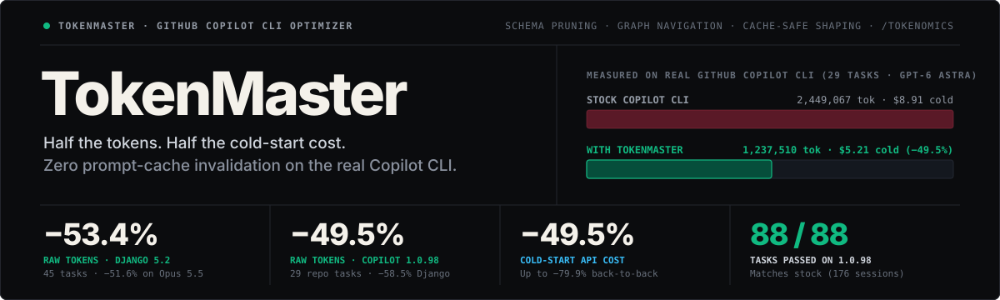

# TokenMaster



**[60-Second Quickstart](#60-second-quickstart)** · **[4-Pillar Architecture](#the-4-pillar-architecture)** · **[`/tokenomics` Dashboard](#tokenomics--ccusage-for-github-copilot-cli)** · **[Real-CLI Benchmarks](#real-github-copilot-cli-benchmarks)** · **[What Failed Along the Way](#what-failed-along-the-way)** · **[Disclaimer & Evals Index](#experimental-disclaimer-honest-limits--complete-evals-index)**

**TokenMaster** is an experimental toolkit that cuts the raw tokens and API cost that the real **GitHub Copilot CLI** spends on coding tasks—without evicting the provider's prompt cache or degrading answer quality.

Across **554 real Copilot CLI sessions** (`176` pre-registered sessions on Copilot CLI `1.0.98` and `378` exploratory sessions on `1.0.78-3`) with **GPT-6 Astra** and **Claude Opus 5.5**, full TokenMaster cut **raw tokens by 38.0% to 58.5%** and **cold-start API cost by 34.0% to 53.5%** (up to **79.9%** when sessions run back to back in one working folder), while passing **88 of 88** tasks in the pre-registered `1.0.98` study ([see benchmarks](#1-pre-registered-confirmatory-study--copilot-cli-1098)).

---

## Real-CLI Scoreboard at a Glance

Every number below comes from live sessions on the real `copilot.exe` binary against `api.githubcopilot.com`, recounted from raw per-call captures and verified against GitHub's own `copilot_usage` / `total_nano_aiu` billing records (`$1 = 10^{11}$ nano-AIU). We report **both** cost regimes: **Cold-Repriced** (every session's first call priced as a cache miss—the realistic baseline when sessions start >30 minutes apart) and **As-Run** (sessions run back to back in one working folder).

| Study & Workload | Copilot CLI | Model | Raw Tokens (`Stock → TM`) | Cold-Start Cost | Back-to-Back Cost | Passed (`Stock vs TM`) |
| :--- | :--- | :--- | ---: | ---: | ---: | ---: |
| **[This Repo (29 tasks)](#1-pre-registered-confirmatory-study--copilot-cli-1098)** *(pre-registered)* | `1.0.98` | `gpt-6-astra` | **−49.5%** (`2.45M → 1.24M`) | **−41.5%** (`$8.91 → $5.21`) | **−50.2%** (`$6.83 → $3.40`) | **29/29 vs 29/29** |
| **[This Repo (29 tasks)](#1-pre-registered-confirmatory-study--copilot-cli-1098)** *(pre-registered)* | `1.0.98` | `claude-opus-5.5` | **−38.0%** (`2.67M → 1.66M`) | **−34.0%** (`$4.23 → $2.79`) | **−40.1%** (`$2.72 → $1.63`) | **29/29 vs 29/29** |
| **[Django 5.2 (15 tasks)](#1-pre-registered-confirmatory-study--copilot-cli-1098)** *(pre-registered)* | `1.0.98` | `gpt-6-astra` | **−58.5%** (`708k → 294k`) | **−53.5%** (`$3.40 → $1.58`) | **−70.7%** (`$2.36 → $0.69`) | **15/15 vs 15/15** |
| **[Django 5.2 (15 tasks)](#1-pre-registered-confirmatory-study--copilot-cli-1098)** *(pre-registered)* | `1.0.98` | `claude-opus-5.5` | **−53.7%** (`990k → 458k`) | **−46.0%** (`$1.81 → $0.98`) | **−61.2%** (`$1.11 → $0.43`) | **15/15 vs 15/15** |
| **[Django 5.2 (45 tasks)](#2-exploratory-real-cli-runs--copilot-cli-1078-3-october-1822-2026)** *(exploratory)* | `1.0.78-3` | `gpt-6-astra` | **−53.4%** (`2.42M → 1.13M`) | **−49.5%** (`$11.55 → $5.83`) | **−79.9%** (`$11.55 → $2.33`) | **45/45 vs 44/45** |
| **[Django 5.2 (45 tasks)](#2-exploratory-real-cli-runs--copilot-cli-1078-3-october-1822-2026)** *(exploratory)* | `1.0.78-3` | `claude-opus-5.5` | **−51.6%** (`3.46M → 1.67M`) | **−46.0%** (`$6.14 → $3.31`) | **−60.8%** (`$3.31 → $1.30`) | **45/45 vs 44/45** |
| **[This Repo (27 tasks)](#2-exploratory-real-cli-runs--copilot-cli-1078-3-october-1822-2026)** *(exploratory)* | `1.0.78-3` | `gpt-6-astra` | **−44.8%** (`2.40M → 1.33M`) | **−40.8%** (`$9.05 → $5.36`) | **−62.8%** (`$9.05 → $3.37`) | **27/27 vs 27/27** |
| **[This Repo (27 tasks)](#2-exploratory-real-cli-runs--copilot-cli-1078-3-october-1822-2026)** *(exploratory)* | `1.0.78-3` | `claude-opus-5.5` | **−53.5%** (`3.05M → 1.42M`) | **−43.9%** (`$4.49 → $2.52`) | **−51.2%** (`$2.75 → $1.34`) | **27/27 vs 26/27** |

---

## 60-Second Quickstart

Run from `token-master-plugin/skills/token-master/`:

```powershell
# 1. Install the Copilot CLI launcher, output-shaping hook, bridge, and /tokenomics skill
python brainspace_setup.py --host copilot --python <runtime> --tokenizer-file <cl100k_base.tiktoken>

# 2. Index a repository for graph-first code navigation (requires `uv tool install graphify`)
python setup.py <repo> --host copilot --python <runtime>

# 3. Launch Copilot CLI through TokenMaster (plain `copilot` stays untouched)
python <COPILOT_HOME>/token-master/brainspace_copilot_bridge.py -- copilot
```

- **Default GitHub routing:** The launcher applies the **lean tool set** (`--excluded-tools`), and Copilot CLI loads the **`tokenmaster-nav`** MCP server (`locate`, `read_symbol`, `impact`) and the **one-shot `view` output-shaping hook**.
- **Bring-your-own-model (`COPILOT_PROVIDER_BASE_URL` set):** The launcher also routes requests through the local **BYOK bridge** (cache-stable system prompt + one-shot shaping of `rg`/`glob`/`view` results).
- **Need subagents (`task`), skills, or background PowerShell?** Pass `--all-tools` before `--` to keep all 11 built-in tools.
- **See your live token and dollar savings:** Type `/tokenomics` inside an interactive Copilot CLI session, or run `python <COPILOT_HOME>/token-master/tokenomics.py` directly in any terminal for zero model token cost.

Full setup guide: **[COPILOT_BRIDGE.md](token-master-plugin/docs/COPILOT_BRIDGE.md)**.

---

## The 4-Pillar Architecture

Why does stock Copilot CLI burn so many tokens? Because **fixed per-turn overhead and blind text search dominate real coding sessions**:
- Stock Copilot CLI re-sends **11,083 to 20,871 fixed tokens** of system prompt and tool schemas on *every single model call*.
- A repository-wide `rg` for a common symbol on Django 5.2 can dump up to **115,555 tokens** of raw matches (`507,193` tokens for `format`), forcing extra model calls.
- Naive "context compression" that rewrites earlier messages invalidates the provider's prompt cache—raising cache-weighted cost by **+61.6%** in our pre-registered [history-rewriting test](#what-failed-along-the-way).

TokenMaster attacks all four sources of waste without mutating conversation history:

```text
┌────────────────────────────────────────────────────────────────────────────────────────┐
│ 1. TOOL-SCHEMA PRUNING (`brainspace_copilot_bridge.py`)                                │
│    Stock Copilot CLI re-sends JSON schemas and system-prompt instructions for SQL      │
│    scratchpads, session-store SQL, background job managers, and CLI docs on every      │
│    turn. Pruning non-core schemas via native `--excluded-tools` cuts ~50% of fixed     │
│    per-call overhead (~5,500 to ~11,500 tokens saved per call).                        │
├────────────────────────────────────────────────────────────────────────────────────────┤
│ 2. GRAPH-FIRST CODE NAVIGATION (`tokenmaster-nav` · Graphify 0.9.91 + SQLite AST)      │
│    3 compact tools (`locate`, `read_symbol`, `impact`) capped at <2,400 tokens.        │
│    Resolves `import ... as ...` aliases. Cuts a further 15.4% (Astra) & 9.8% (Opus)    │
│    of raw tokens on top of schema pruning by eliminating exploratory grep turns.       │
├────────────────────────────────────────────────────────────────────────────────────────┤
│ 3. ONE-SHOT TOOL-RESULT SHAPING (`brainspace/request_policy.py`)                       │
│    Folds `rg`/`glob` output losslessly and compacts oversized `view` reads ONCE when   │
│    appended. Never rewrites earlier messages—100% prompt-cache safe (−11.6% to −13.0%  │
│    cost in controlled studies).                                                        │
├────────────────────────────────────────────────────────────────────────────────────────┤
│ 4. CACHE-STABLE BYOK BRIDGE (`stable_session_prefix`)                                  │
│    Moves the per-session `Session folder:` UUID out of the system prompt into the      │
│    first user turn so sessions in the same working folder share the cached prefix      │
│    (`322` vs `4,882` median first-call cache-write tokens on 1.0.98 Astra).            │
└────────────────────────────────────────────────────────────────────────────────────────┘
```

### Pillar Breakdown & Measured Impact

| Pillar | What It Does | Measured Effect | Known Trade-Off |
| :--- | :--- | :--- | :--- |
| **1. Tool-Schema Pruning** | Uses Copilot CLI's native `--excluded-tools` flag to omit non-core built-in subsystems (SQL scratchpads `sql`/`session_store_sql`, background job polling `read_powershell`/`stop_powershell`/`list_powershell`, agent/skill loaders, CLI docs lookup) while keeping core coding tools (`view`, `edit`, `create`, `rg`, `glob`, `powershell`). Respects any user-supplied `--available-tools` / `--excluded-tools`, or `--all-tools`. | Removes **5,558** (`gpt-6-astra`) and **9,727** (`claude-opus-5.5`) fixed tokens per call on `1.0.98` (**50.1%** and **53.7%** of the first call; `6,775` and `11,552` on `1.0.78-3`). | One stock session on Oct 19 (`P13`) called `task` (subagent) and spent `124,403` tokens in 8 calls vs TokenMaster's `38,154` in 4 calls. Pass `--all-tools` when subagents or background PowerShell polling are needed. |
| **2. Graph-First Navigation** | Combines `graphify update` call edges (`Graphify 0.9.91`) with a local SQLite AST symbol index (`brainspace/symbol_index.py`) exposing `locate(query)`, `read_symbol(target)`, and `impact(symbol, depth)`. | On 40 random Django symbols, `impact` returned **8,401** total tokens (max `2,325`) vs **128,279** for raw `rg` (max `115,555`). In the 45-task Django A/B, added **−15.4%** (`gpt-6-astra`) and **−9.8%** (`claude-opus-5.5`) raw-token savings on top of the lean tool set. Resolves `import ... as ...` aliases (`56/56` caller recall on `D01`–`D15`, including `auth_login` in `D13`). | Static AST + call graph does not resolve dynamic `getattr`, string-based dispatch, or monkeypatching (`impact` prints a `[Not listed: N calls ...]` footer so the agent can fall back to narrow `rg`). |
| **3. One-Shot Output Shaping** | Shapes tool output once at ingestion—lossless prefix/table folding for search results and budgeted digests for oversized file reads—without ever touching prior turns. | Cut billed cost by **−11.6%** ($p = 0.014$) and **−13.0%** ($p = 0.0001$) in controlled studies with **156/156** tasks passed, avoiding the **+61.6%** cache-eviction penalty of history-rewriting compression. | Smaller effect than the lean tool set on short real-CLI sessions where fixed prompt overhead dominates. |
| **4. Cache-Stable BYOK Bridge** | Relocates the per-session `Session folder:` UUID from the system prompt to the first user message so back-to-back sessions in the same directory hit the provider's prompt cache on call 1. | On `1.0.78-3` (`gpt-6-astra`), raised warm first calls from **0/45** (stock) to **44/45** (TokenMaster). On `1.0.98`, reduced median first-call cache writes from **4,882 → 322** tokens (`gpt-6-astra`) and **7,265 → 543** (`claude-opus-5.5`). | Applies only in BYOK mode (`COPILOT_PROVIDER_BASE_URL`) and within the same working directory while the provider's cache is warm (`6.5` to `31` minutes in our probe). |

---

## `/tokenomics` — `ccusage` for GitHub Copilot CLI

`/tokenomics` (`tokenomics.py`) gives GitHub Copilot CLI the same local usage and cost visibility that [ccusage](https://github.com/ryoppippi/ccusage) gives Claude Code—plus a validated counterfactual estimate of what TokenMaster saved you.

- **100% local & read-only:** Reads measured token counts and GitHub's exact per-call charge (`total_nano_aiu`, where $10^9\text{ nano-AIU} = 1\text{ AI credit} = \$0.01$) from `<COPILOT_HOME>/session-store.db`, and attributes TokenMaster sessions via `<COPILOT_HOME>/token-master/launches.jsonl` (start/end timestamps, working directory, and active `lean`/`bridge`/`nav` flags—zero prompt text).
- **Interactive or zero-token CLI:** Type `/tokenomics` (or `/tokenomics session --since 20261020`, `/tokenomics monthly --breakdown`) inside Copilot CLI, or run `python <COPILOT_HOME>/token-master/tokenomics.py` directly in your terminal to spend **zero model tokens**.

```text
┌──────────┬───────────────┬──────────────┬────────────┬──────────────┬────────────────┬───────────────┐
│ Session  │ Models        │ Total Tokens │ Cost (USD) │ TokenMaster  │ Saved Tokens ≈ │ Saved (USD) ≈ │
├──────────┼───────────────┼──────────────┼────────────┼──────────────┼────────────────┼───────────────┤
│ 579e5c15 │ • gpt-6-astra │       22,278 │      $0.15 │ -            │              - │             - │
│ repo     │               │              │            │              │                │               │
├──────────┼───────────────┼──────────────┼────────────┼──────────────┼────────────────┼───────────────┤
│ 9b2700f4 │ • gpt-6-astra │       16,847 │      $0.09 │ lean+bridge  │         16,674 │         $0.01 │
│ repo     │               │              │            │              │                │               │
├──────────┼───────────────┼──────────────┼────────────┼──────────────┼────────────────┼───────────────┤
│ 5690993e │ • gpt-6-astra │       16,844 │      $0.02 │ lean+bridge  │         16,674 │         $0.07 │
│ repo     │               │              │            │              │                │               │
├──────────┼───────────────┼──────────────┼────────────┼──────────────┼────────────────┼───────────────┤
│ Total    │               │       55,969 │      $0.26 │ 2/3 sessions │         33,348 │         $0.08 │
└──────────┴───────────────┴──────────────┴────────────┴──────────────┴────────────────┴───────────────┘

TokenMaster savings (estimated)
  TokenMaster sessions          2 of 3  6 model calls
  Tokens, actual                33,691  GitHub's token counts
  Tokens without TokenMaster ≈  67,039  saved 33,348 (49.7%)
  Cost, actual                   $0.11  GitHub's own charge per call
  Cost without TokenMaster ≈     $0.18  saved $0.08 (41.0%)
    of which lean tool set       $0.03  33,348 fewer fixed tokens, priced as cache reads
    of which first calls         $0.04  prompt-cache writes on each session's first call
```

### How `/tokenomics` Estimates Savings (Validated Across 10 A/B Runs)

Because a single user session has no parallel stock twin, `/tokenomics` estimates counterfactual stock usage from two per-call terms (`lean − nav` fixed tokens removed per main-agent call at cache-read price, plus first-call prompt-cache writes avoided relative to the median first-call cache read of your own stock sessions in `session-store.db`). It **does not** credit model calls avoided by `tokenmaster-nav` or output shaping, making it conservative whenever graph navigation saves turns.

Tested across **10 real-CLI A/B runs** (`4` out-of-sample runs on `1.0.98` using the pre-frozen October 23 probe calibration, plus `6` runs on `1.0.78-3`; see **[TOKENOMICS.md](token-master-plugin/docs/TOKENOMICS.md)**):

| Model | Copilot CLI | Benchmark Run | Estimated Token Saving | Measured Token Saving | Estimated Cost Saving | Measured Cost Saving |
| :--- | :--- | :--- | ---: | ---: | ---: | ---: |
| `gpt-6-astra` | `1.0.98` *(out-of-sample)* | This Repo (29 tasks, full TM) | **−38.0%** | **−49.5%** | **−39.1%** | **−50.2%** |
| `gpt-6-astra` | `1.0.98` *(out-of-sample)* | Django 5.2 (15 tasks, full TM) | **−45.4%** | **−58.5%** | **−57.5%** | **−70.7%** |
| `claude-opus-5.5` | `1.0.98` *(out-of-sample)* | This Repo (29 tasks, full TM) | **−43.2%** | **−38.0%** | **−40.9%** | **−40.1%** |
| `claude-opus-5.5` | `1.0.98` *(out-of-sample)* | Django 5.2 (15 tasks, full TM) | **−48.0%** | **−53.7%** | **−52.9%** | **−61.2%** |
| `gpt-6-astra` | `1.0.78-3` | Django 5.2 (45 tasks, full TM) | **−45.2%** | **−53.4%** | **−77.0%** | **−79.9%** |
| `gpt-6-astra` | `1.0.78-3` | Django 5.2 (45 tasks, without graphify) | **−45.1%** | **−44.9%** | **−70.3%** | **−70.8%** |
| `gpt-6-astra` | `1.0.78-3` | This Repo (27 tasks, full TM) | **−39.5%** | **−44.8%** | **−59.1%** | **−62.8%** |
| `claude-opus-5.5` | `1.0.78-3` | Django 5.2 (45 tasks, full TM) | **−49.7%** | **−51.6%** | **−58.5%** | **−60.8%** |
| `claude-opus-5.5` | `1.0.78-3` | Django 5.2 (45 tasks, without graphify) | **−52.0%** | **−46.3%** | **−56.2%** | **−55.2%** |
| `claude-opus-5.5` | `1.0.78-3` | This Repo (27 tasks, full TM) | **−47.4%** | **−53.5%** | **−45.4%** | **−51.2%** |

---

## Real GitHub Copilot CLI Benchmarks

### 1. Pre-Registered Confirmatory Study — Copilot CLI `1.0.98`

- **Pre-registration:** Protocol, tasks, and product code were committed before any study call (**[PRS6_PROTOCOL.md](token-master-plugin/docs/PRS6_PROTOCOL.md)**, commit `19443fc`; evidence and recount script in `evidence/prs6-copilot-1.0.98-20261026/`).
- **Binary verification:** Pinning `COPILOT_CLI_DIST_DIR` to `1.0.98` and removing `--no-auto-update` ran real Copilot CLI `1.0.98`, verified in **176 of 176** session captures (`Version number: 1.0.98`, `0` recount mismatches, per-call `total_nano_aiu` matching calculated USD within `$0.0001`).

#### Primary Confirmatory Benchmark: This Repository (`29` Tasks per Model, `116` Sessions)

Tasks: 24 repository tasks (`P01`–`P24`: locate 6, logic 6, impact 4, docs 4, edit 4) plus 5 multi-file heavy tasks (`H01`, `H02`, `H03`, `H05`, `H06`: 3 investigations, 2 multi-file edits). Both models exceeded the pre-declared **2,000,000 raw-token** stock workload floor.

| Endpoint (`29` tasks per model, `1.0.98`) | Stock `1.0.98` | Full TokenMaster | Paired Change (95% CI) | Tasks Lower | Wilcoxon / Holm $p$ |
| :--- | ---: | ---: | ---: | ---: | ---: |
| **`gpt-6-astra` raw tokens** *(co-primary)* | 2,449,067 | **1,237,510** | **−49.5%** (−55.9%, −42.3%) | **27 / 29** | $p < 0.0001$ / $< 0.0001$ |
| **`gpt-6-astra` cold-repriced cost** *(co-primary)* | $8.91 | **$5.21** | **−41.5%** (−47.7%, −35.5%) | **28 / 29** | $p < 0.0001$ / $< 0.0001$ |
| `gpt-6-astra` as-run cost (back to back) | $6.83 | **$3.40** | **−50.2%** (−59.6%, −42.0%) | 28 / 29 | $p < 0.0001$ |
| `gpt-6-astra` model calls & pass count | 171 calls (29/29) | **143 calls (29/29)** | **−16.4% calls** (`124` nav calls) | 18 / 29 | $p = 0.0083$ |
| **`claude-opus-5.5` raw tokens** *(co-primary)* | 2,672,316 | **1,655,797** | **−38.0%** (−44.7%, −31.3%) | **27 / 29** | $p < 0.0001$ / $< 0.0001$ |
| **`claude-opus-5.5` cold-repriced cost** *(co-primary)* | $4.23 | **$2.79** | **−34.0%** (−38.7%, −29.3%) | **28 / 29** | $p < 0.0001$ / $< 0.0001$ |
| `claude-opus-5.5` as-run cost (back to back) | $2.72 | **$1.63** | **−40.1%** (−48.2%, −32.3%) | 28 / 29 | $p < 0.0001$ |
| `claude-opus-5.5` model calls & pass count | 127 calls (29/29) | **137 calls (29/29)** | +7.9% calls (`8` nav calls) | 6 / 29 | $p = 0.136$ (n.s.) |

#### Django 5.2 Caller Replication on `1.0.98` with Import-Alias Resolution (`D01`–`D15`, `60` Sessions)

`brainspace/symbol_index.py` resolves `import a as b` and `from a import b as c` (minus shadowed function parameters), so `impact("django/contrib/auth/__init__.py::login")` directly finds `auth_login(...)` callers in `django/contrib/auth/views.py` (`D13`), raising `D01`–`D15` caller recall from `54/56` to **`56/56`**.

| Endpoint (`D01`–`D15` on Django 5.2, `1.0.98`) | Stock `1.0.98` | Full TokenMaster | Paired Change (95% CI) | Tasks Lower | Passed |
| :--- | ---: | ---: | ---: | ---: | ---: |
| **`gpt-6-astra` raw tokens** | 707,799 | **293,779** | **−58.5%** (−64.4%, −52.3%) | **15 / 15** | **15/15 vs 15/15** |
| **`gpt-6-astra` cold-repriced / as-run cost** | $3.40 / $2.36 | **$1.58 / $0.69** | **−53.5% cold / −70.7% as-run** | **15 / 15** | **15/15 vs 15/15** |
| **`claude-opus-5.5` raw tokens** | 989,925 | **457,875** | **−53.7%** (−57.8%, −48.9%) | **15 / 15** | **15/15 vs 15/15** |
| **`claude-opus-5.5` cold-repriced / as-run cost** | $1.81 / $1.11 | **$0.98 / $0.43** | **−46.0% cold / −61.2% as-run** | **15 / 15** | **15/15 vs 15/15** |

---

### 2. Exploratory Real-CLI Runs — Copilot CLI `1.0.78-3` (October 18–22, 2026)

Our October 18–22 runs used `--no-auto-update`, which causes the Windows WinGet `copilot.exe` launcher to run its bundled **`1.0.78-3`** build even when `1.0.98` is installed ([version discovery & probe](token-master-plugin/docs/COPILOT_CLI_RESULTS.md#copilot-cli-version)). These runs were exploratory (not pre-registered) and isolated **TokenMaster without graphify** (`brainspace_setup.py` only: lean tool set + bridge) from **Full TokenMaster** (`+ setup.py` graph navigation).

#### 45 "Who Calls X?" Tasks on Django 5.2 (`270` Sessions, `2,818` Python Files)

25 rare symbol names + 20 common symbol names (where a bare repository-wide `rg -n -w <name>` returns `2,496` to `507,193` tokens):

| 45 Tasks per Model (`1.0.78-3`) | Stock Copilot CLI | TokenMaster (No Graphify) | Full TokenMaster (+ Graphify `0.9.91`) |
| :--- | ---: | ---: | ---: |
| **`gpt-6-astra` raw tokens** | 2,417,452 | 1,331,990 (−44.9%) | **1,127,277 (−53.4%; CI −57.1%, −49.1%)** |
| **`gpt-6-astra` cost, every first call cold** | $11.55 | $6.74 (−41.6%) | **$5.83 (−49.5%; CI −51.5%, −47.5%)** |
| **`gpt-6-astra` cost, as run (back to back)** | $11.55 | $3.37 (−70.8%) | **$2.33 (−79.9%; CI −82.0%, −77.6%)** |
| **`claude-opus-5.5` raw tokens** | 3,457,179 | 1,855,563 (−46.3%) | **1,673,646 (−51.6%; CI −55.7%, −47.2%)** |
| **`claude-opus-5.5` cost, every first call cold** | $6.14 | $3.39 (−44.8%) | **$3.31 (−46.0%; CI −48.0%, −44.0%)** |
| **`claude-opus-5.5` cost, as run (back to back)** | $3.31 | $1.48 (−55.2%) | **$1.30 (−60.8%; CI −64.6%, −56.9%)** |
| **Correct answers (both models combined)** | **90 / 90** | **88 / 90** | **88 / 90** *(all 4 misses model errors)* |

- **100% task win rate on raw tokens:** Full TokenMaster used fewer raw tokens than stock on **45 of 45** tasks with `gpt-6-astra` and **45 of 45** tasks with `claude-opus-5.5`.
- **Graphify's isolated share:** On top of TokenMaster without graphify, `tokenmaster-nav` cut a further **15.4%** of raw tokens with `gpt-6-astra` (95% CI −21.7% to −8.1%) and **9.8%** with `claude-opus-5.5` (95% CI −18.4% to −0.8%), reducing total model calls from `162 → 143` (`gpt-6-astra`) and `174 → 150` (`claude-opus-5.5`).
- **Why `1.0.78-3` vs `1.0.98` back-to-back cost differs:** On `1.0.78-3`, stock `gpt-6-astra` cached **0 of 45** first calls because `1.0.78-3` embeds the per-session UUID early in the system prompt, costing `$7.65` in first-call cache writes alone. On `1.0.98`, stock caches the prefix before that line (`6,450` tokens on `gpt-6-astra`, `11,226` on `claude-opus-5.5`), narrowing the back-to-back cache-write gap while leaving **raw-token** and **cold-start cost** savings at **~40%–58%**.

Full analysis: **[COPILOT_CLI_RESULTS.md](token-master-plugin/docs/COPILOT_CLI_RESULTS.md)**.

---

## What Failed Along the Way

We ran four pre-registered replica-harness studies (**1,092 live sessions** on `gpt-6-astra`) and published every negative result and retraction before testing on the real Copilot CLI:

| Experiment / Iteration | What We Tested | What Happened (and Why) |
| :--- | :--- | :--- |
| **Oct 17 Synthetic Claims** *(Retracted)* | Early synthetic scripts claiming `−43.14%` to `−83.29%` token reductions. | **Withdrawn on Oct 18, 2026.** Came from repetitive synthetic files, scripted reads, extra baseline tools, and ignoring prompt caching. |
| **Early Compilers (`v1`–`v4`)** | Tree-sitter function skeletons (`v1`/`v2`), duplicate-read reuse (`v3`), JSON whitespace stripping (`v4`). | `0%` to `1.43%` savings on real tasks; skeleton recovery calls cost more tokens than they saved. |
| **History-Rewriting Compaction (`v5`, [PRS-1](token-master-plugin/docs/PRS1_RESULTS.md))** (`252` sessions) | Rewriting older `view` tool outputs in conversation history into `[[BR:<sha256>\|r=1]]` references. | **Raised cache-weighted cost by +61.6%** (95% CI +19.6% to +111.0%) and raw tokens by +7.8%. Mutating earlier turns invalidates the provider's prompt cache on every subsequent call. **Abandoned.** |
| **Multi-Server Graph MCPs ([PRS-2](token-master-plugin/docs/PRS2_RESULTS.md))** (`144` sessions) | Shipping 6-tool `graphify-nav` + `codegraph` MCP servers simultaneously alongside one-shot output shaping. | The heavy MCP servers **raised cost by +12.9%** (`~2,100` fixed schema tokens added to every call). Meanwhile, one-shot **output shaping alone cut cost by −11.6%** (Holm $p = 0.014$, `36/36` passed). |
| **3-Tool Graph Navigation ([PRS-3](token-master-plugin/docs/PRS3_RESULTS.md))** (`480` sessions) | Replacing the heavy MCP servers with 3 compact tools (`locate`, `read_symbol`, `impact`, ~252 tokens total) + one-shot shaping. | One-shot shaping cut cost by **−13.0%** ($p = 0.0001$); adding 3-tool graph navigation cut cost by **−22.0%** ($p = 0.006$, `120/120` passed), with **−52%** on caller-impact tasks. |
| **Cache-Stable System Prompt ([PRS-4](token-master-plugin/docs/PRS4_RESULTS.md))** (`360` sessions) | Normalizing per-session UUIDs out of the system prompt (`stable_session_prefix`) across back-to-back sessions on one repo. | **Cut billed cost per finished task by −49.8%** (95% CI −57.1% to −42.9%, Holm $p < 0.00001$, `120/120` passed; `−18.9%` when repriced cold). |

---

## Experimental Disclaimer, Honest Limits & Complete Evals Index

> **Experimental Research Software Disclaimer:** TokenMaster is an **experimental research toolkit**, not an officially supported GitHub Copilot product. While every benchmark in this repository uses real API calls, exact token recounts, and verifiable billing records, you should understand the exact boundaries of our evaluations before deploying it in production workflows:
>
> 1. **BYOK vs. Default GitHub Routing:** All real-CLI A/B benchmarks ran in offline bring-your-own-model (`BYOK`) mode through a local recording relay so we could capture exact wire payloads and `copilot_usage` bills. When you run Copilot CLI with its default GitHub routing, the launcher still applies the **lean tool set**, **Graphify code navigation (`tokenmaster-nav`)**, and the **one-shot `view` output hook**, but the **BYOK bridge (`stable_session_prefix`) does not run**.
> 2. **Excluded Tools (`--excluded-tools`):** The lean tool set removes 11 built-in tools (`session_store_sql`, `task`, `read_agent`, `write_agent`, `list_agents`, `skill`, `sql`, `read_powershell`, `stop_powershell`, `list_powershell`, `fetch_copilot_cli_documentation`). Workloads that rely on subagents (`task`), skills, or background PowerShell jobs must launch with `--all-tools`.
> 3. **Prompt-Cache Lifetime & Timing Sensitivity:** Provider prompt caches expire after roughly **6.5 to 31 minutes** of inactivity. Back-to-back session runs (`−50.2%` to `−79.9%` cost) represent a best case; isolated sessions spaced far apart should expect the **cold-repriced cost savings (`−34.0%` to `−53.5%`)**, which closely track raw-token savings.
> 4. **Scope of Benchmarks:** Real-CLI evaluations cover two codebases (this repository at commit `703aa20` and Django 5.2 at commit `9e7cc2b6`), two frontier models (`gpt-6-astra` and `claude-opus-5.5`), and Windows (`win32-x64`). Cost calculations use GitHub's published per-token rates (`$10/$1/$12.50/$50` per 1M for `gpt-6-astra`; `$4/$0.20/$5/$20` per 1M for `claude-opus-5.5`) and do not model seat-plan allowances.
> 5. **Test Suite Status (`4,450 passed, 5 skipped, 0 non-WSL failures`):** Running `pytest` across all 106 test files (`4,531` tests) plus all 6 study `self-test`s passes `4,450` tests and `6/6` study self-tests on Windows. The remaining `76` tests (`test_fresh_coding_cases.py` 34, `test_quality_sandbox.py` 42) require a local `wsl.exe -d Ubuntu` Linux sandbox and fail closed when WSL Ubuntu is not installed.

### Complete Index of Evaluations, Protocols & Evidence

| Evaluation / Document | Type | Scope & Models | Documentation & Protocol | Raw Evidence & Audit Scripts |
| :--- | :--- | :--- | :--- | :--- |
| **Copilot CLI `1.0.98` Study (PRS-6)** | **Pre-Registered Real-CLI A/B** | 29 Repo tasks (`116` sessions) + 15 Django tasks (`60` sessions), `gpt-6-astra` & `claude-opus-5.5` | [PRS6_PROTOCOL.md](token-master-plugin/docs/PRS6_PROTOCOL.md) · [COPILOT_CLI_RESULTS.md](token-master-plugin/docs/COPILOT_CLI_RESULTS.md) | [`evidence/prs6-copilot-1.0.98-20261026/`](evidence/prs6-copilot-1.0.98-20261026/) (`analyze.py`, `analysis.json`, `capture_audit.json`, `calls.jsonl`) |
| **Django 5.2 Scale (`1.0.78-3`)** | Exploratory Real-CLI A/B (3 arms) | 45 caller tasks (`270` sessions), Stock vs. Lean vs. Full TM (`Graphify 0.9.91`), `gpt-6-astra` & `claude-opus-5.5` | [COPILOT_CLI_RESULTS.md](token-master-plugin/docs/COPILOT_CLI_RESULTS.md#result-1-45-who-calls-x-tasks-on-django-52-october-22) | [`evidence/django-scale-20261022/`](evidence/django-scale-20261022/) (`audit.py`, `analyze.py`, `summary.json`, `analysis.json`) |
| **Repo 27-Task (`1.0.78-3`)** | Exploratory Real-CLI A/B | 27 tasks (`P01`–`P24` + `H02, H03, H05`, `108` sessions), `gpt-6-astra` & `claude-opus-5.5` | [COPILOT_CLI_RESULTS.md](token-master-plugin/docs/COPILOT_CLI_RESULTS.md#result-2-27-tasks-on-this-repository-october-19) | [`evidence/copilot-lean-analysis-20261022/`](evidence/copilot-lean-analysis-20261022/) · `evidence/copilot-lean-{astra,opus}-{a,b}-20261019/` |
| **`/tokenomics` Validation** | Counterfactual Estimator Audit | Out-of-sample `1.0.98` (4 runs) + `1.0.78-3` (6 runs) estimator vs. measured stock | [TOKENOMICS.md](token-master-plugin/docs/TOKENOMICS.md) | [`evidence/tokenomics-validation-20261023/`](evidence/tokenomics-validation-20261023/) · [`evidence/tokenomics-check-20261023/`](evidence/tokenomics-check-20261023/) |
| **CLI Version & Output Probe** | Mechanism & Cache Probe | `1.0.98` vs `1.0.78-3` fixed prompt sizes, cache reads/writes, Opus 32k output limit | [COPILOT_CLI_RESULTS.md](token-master-plugin/docs/COPILOT_CLI_RESULTS.md#copilot-cli-version) · [COPILOT_BRIDGE.md](token-master-plugin/docs/COPILOT_BRIDGE.md) | [`evidence/copilot-version-probe-20261023/`](evidence/copilot-version-probe-20261023/) · [`evidence/lean-tools-20261019/`](evidence/lean-tools-20261019/) |
| **Grep vs. Graph & Graphify `0.9.91`** | Tool Output & Recall Benchmark | 40 random symbols on Django & this repo; `Graphify 0.9.84` vs `0.9.91` + SQLite AST index | [COPILOT_CLI_RESULTS.md](token-master-plugin/docs/COPILOT_CLI_RESULTS.md#grep-and-graph-lookups-without-a-model-october-19) | [`evidence/grep-vs-graph-20261019/`](evidence/grep-vs-graph-20261019/) · [`evidence/graphify-upgrade-20261022/`](evidence/graphify-upgrade-20261022/) |
| **PRS-4 (Replica Harness)** | Pre-Registered 3-Arm Study | 24 tasks (`360` sessions), 3-tool graph nav + cache-stable prefix (`−49.8%` billed cost) | [PRS4_PROTOCOL.md](token-master-plugin/docs/PRS4_PROTOCOL.md) · [PRS4_RESULTS.md](token-master-plugin/docs/PRS4_RESULTS.md) | [`token-master-plugin/evals/run_prs4_study.py`](token-master-plugin/evals/run_prs4_study.py) |
| **PRS-3 (Replica Harness)** | Pre-Registered 4-Arm Study | 24 tasks (`480` sessions), one-shot shaping (`−13.0%`) & 3-tool graph nav (`−22.0%` cost) | [PRS3_PROTOCOL.md](token-master-plugin/docs/PRS3_PROTOCOL.md) · [PRS3_RESULTS.md](token-master-plugin/docs/PRS3_RESULTS.md) | [`token-master-plugin/evals/run_prs3_study.py`](token-master-plugin/evals/run_prs3_study.py) |
| **PRS-2 (Replica Harness)** | Pre-Registered 4-Arm Study | 12 tasks (`144` sessions), one-shot shaping (`−11.6%` cost) vs. legacy graph MCP (`+12.9%`) | [PRS2_PROTOCOL.md](token-master-plugin/docs/PRS2_PROTOCOL.md) · [PRS2_RESULTS.md](token-master-plugin/docs/PRS2_RESULTS.md) | [`token-master-plugin/evals/run_prs2_study.py`](token-master-plugin/evals/run_prs2_study.py) |
| **PRS-1 (Replica Harness)** | Pre-Registered 7-Arm Study | 12 tasks (`252` sessions), history-rewriting cache-invalidation finding (`+61.6%` cost) | [PRS1_PROTOCOL.md](token-master-plugin/docs/PRS1_PROTOCOL.md) · [PRS1_RESULTS.md](token-master-plugin/docs/PRS1_RESULTS.md) | [`token-master-plugin/evals/run_prs1_study.py`](token-master-plugin/evals/run_prs1_study.py) |
| **Live Demo Deck & Runbook** | Interactive HTML Deck + Script | 15-minute live demo runbook and interactive prompt-cache architecture visual deck | [DEMO_SCRIPT.md](docs/DEMO_SCRIPT.md) · [tokenomics-demo-slide.html](docs/tokenomics-demo-slide.html) | [Documentation Index](token-master-plugin/docs/README.md) |
