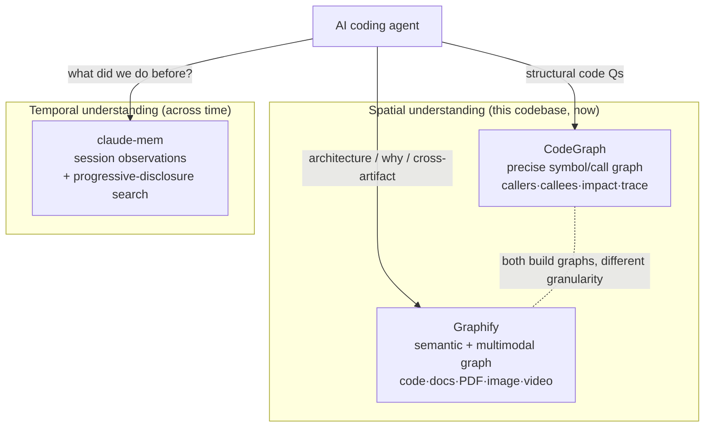
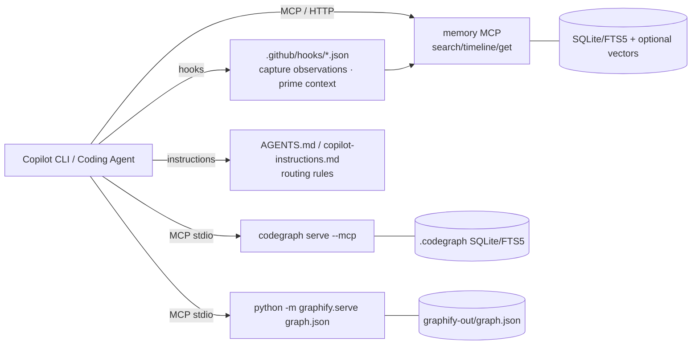

# Redefining Token Economics at the Harness Level — Deep Research & GitHub Copilot Feasibility

**Date:** 2026‑05‑31
**Author:** Copilot CLI research run
**Mission:** See [`MISSION.md`](./MISSION.md). This project is **not** "merge three repos into one." It is an attack on the dominant form of agent waste — **the model re‑processing context it has already seen** — at the harness level (the layer that decides what context the model sees each turn). Graphify, CodeGraph, and claude‑mem are treated as **evidence and suppliers of structure**, not as the product.
**Scope:** Use the three open‑source "harness" projects as evidence, determine how their patterns combine into a single routing layer that minimizes **cumulative tokens processed per task**, and assess feasibility on **GitHub Copilot (CLI / coding agent)**.

---

## 0. TL;DR (Executive Summary)

You want to combine three tools that each attack token waste from a different angle:

| Project | Core idea | What it saves tokens on |
| --- | --- | --- |
| **Graphify** (`safishamsi/graphify`) | Build a queryable **knowledge graph** of *everything* (code, docs, PDFs, images, video) | Cross‑artifact "understanding" / architecture Q&A instead of grepping files |
| **CodeGraph** (`colbymchenry/codegraph`) | Pre‑index code into a **symbol/call graph** served over MCP, auto‑synced via OS file watchers | Code‑structure exploration (callers/callees/impact) without Read/grep loops |
| **claude‑mem** (`thedotmack/claude-mem`) | **Persistent cross‑session memory** with progressive‑disclosure search (search → timeline → fetch) | Re‑establishing context across sessions; avoids re‑reading history |

**Key finding:** This combination is **feasible and largely complementary** — the three tools overlap less than they appear. Graphify and CodeGraph both build graphs but serve different intents (semantic/multi‑modal vs. precise code structure); claude‑mem is orthogonal (temporal memory, not spatial code structure).

**GitHub Copilot feasibility:**

- **Graphify** — ✅ *Officially supported today*. It ships first‑class installers for **GitHub Copilot CLI** (`graphify install --platform copilot`) and **VS Code Copilot Chat** (`graphify vscode install`).
- **CodeGraph** — 🟡 *Feasible via generic MCP*, but **Copilot is not on its auto‑detect list** (Claude Code, Cursor, Codex, opencode, Hermes, Gemini, Antigravity, Kiro). You'd wire it up manually as a standard stdio MCP server in `~/.copilot/mcp-config.json`. A caveat: CodeGraph delivers its usage instructions via the MCP `initialize` response, which Copilot may surface differently than Claude Code.
- **claude‑mem** — 🟡 *Was rated hardest; now substantially de‑risked.* It is built around **Claude Code's plugin + lifecycle‑hook system**, but **we built and ran a working Copilot prototype** (see §7) proving the memory layer collapses to \~120 lines because **Copilot already ships the storage, the session summarization, and the injection pipe** natively. It is no longer "real engineering work in the claude‑mem sense" — it's a thin retrieval layer over data Copilot maintains for you.

**Bottom line:** A token‑efficient Copilot harness is realistic — **on hard, multi‑hop code‑understanding tasks the graph layer cut cumulative token throughput ~72–80%** (see §7.10, the controlling result) by replacing many‑turn grep traversal with a 3–13 turn graph query. The win is **conditional on task difficulty**: on short structural questions grep answers in ~3 turns, so the graph saves little or is a wash (see §7.9/T3 negative control). The pragmatic build is **Graphify + CodeGraph wired through MCP for spatial/code understanding, plus a thin memory‑recall hook (inspired by claude‑mem's progressive disclosure) that reads Copilot's *own* session store** — not a port of claude‑mem.

> **⚠️ RETRACTION (2026‑06‑01, see §7.9).** The "**−27% tokens**" and "routing reliability is empirically settled / retired" claims below (§7.7–§7.8) are **withdrawn.** They rested on (1) a **billing defect** — summing `total_tokens`, which counts prompt‑cache *reads* at full price, so "−27%" was really "**fewer turns**," not fewer dollars; and (2) **n=1‑per‑cell, axios‑only** data. A corrected, per‑request‑billed re‑run on **express** found: **CodeGraph routed 0/15** (the "8/8" did **not** reproduce — routing is *not* reliable), **Graphify‑aliased routed 6/6 but cost +79%** for identical answers, **grep alone was 100% correct on all 36 runs**, and **no arm produced a real token/cost win.** Read §7.9 as the corrected conclusion; treat §7.7–§7.8 as superseded.

> **🧭 FINAL CONTROLLING RESULT (2026‑06‑01, see §7.10) — TOKEN EFFICIENCY.** A rigorous **16‑run A/B on Django** (992 `.py` files; HARD multi‑hop tasks + a one‑line routing nudge — the two things §7.9 never tested) settles the thesis on its own terms — **cumulative tokens the model actually processes to finish a task**, summed per‑turn from Copilot's own context‑window log (`CompactionProcessor: Utilization … (N/168000 tokens)`), not a billing proxy. **The graph harness cut cumulative input‑token throughput by ~72% overall (3.5×), and up to 80% (5.0×) on the hardest tasks:**
>
> | task | arm A (grep) tokens | arm B (graph) tokens | reduction |
> |---|---:|---:|---:|
> | T1 blast‑radius (callers) | 298,641 | 59,860 | **−80% (5.0×)** |
> | T2 inheritors | 134,128 | 78,157 | **−42% (1.7×)** |
> | T3 signature *(neg. control)* | 53,652 | 55,997 | **+4% (wash)** |
> | T4 two‑hop dependency | 1,215,385 | 288,532 | **−76% (4.2×)** |
> | **ALL** | **1,701,806** | **482,546** | **−72% (3.5×)** |
>
> **Mechanism:** grep re‑sends a *growing* context across **16–40 turns**, so the model re‑processes the entire accumulated context every turn and cumulative throughput explodes; the graph answers the same question in **3–13 turns** with a far smaller working set. **Credibility check:** the **negative‑control task (T3) is a ~wash (+4%)** — the graph does *not* win by artifact; on a task that doesn't need traversal it's neutral‑to‑slightly‑worse, exactly as an honest result should be. **Routing 8/8 (100%)** with the nudge (fixes §7.9's 0/15); **no correctness regression** (T2/T3 4/4 both arms; T4 source‑validated). **Footnote on billing (not the thesis):** Copilot also bills a flat **1 premium request per invocation** regardless of churn, so the dollar line is identical across arms — *irrelevant to a token‑efficiency project; recorded only so it can't be mistaken for the result.* §7.10 is the controlling conclusion.

The surviving actionable rule from §7.7–§7.8 (naming drives *adoption*) still holds — but adoption was shown in §7.9 to be **net‑negative on cost** for short structural questions, so "invest in question‑shaped tool names" is only worthwhile when a graph call genuinely *replaces* multi‑file grep, which these tasks did not require.

---

## 1. The three projects in depth

### 1.1 Graphify (`safishamsi/graphify`)

**Repo:** https://github.com/safishamsi/graphify · **PyPI:** `graphifyy` (double‑y) · CLI command: `graphify` · YC S26.

**What it does.** Type `/graphify` in your AI assistant and it maps the entire project — *code, docs, PDFs, images, videos* — into a knowledge graph you query instead of grepping files. Output is three artifacts in `graphify-out/`:

- `graph.html` — interactive browser visualization
- `GRAPH_REPORT.md` — highlights: "god nodes", surprising connections, suggested questions
- `graph.json` — the full graph, queryable without re‑reading files

**Extraction model (important for tokens/privacy):**

- **Code** is parsed **locally** with tree‑sitter ASTs across **33 languages** — *no API calls*.
- **Docs / PDFs / images / video** go through the model API (your IDE session's model when run via the skill; or an explicit backend key in headless `graphify extract`). Video/audio transcribed locally with faster‑whisper.

**Query / programmatic interface:**

```javascript
graphify query "what connects auth to the database?"
graphify path  "UserService" "DatabasePool"
graphify explain "RateLimiter"
```

It can also expose the graph as an **MCP server**:

```javascript
python -m graphify.serve graphify-out/graph.json
```

…providing tools: `query_graph`, `get_node`, `get_neighbors`, `shortest_path`, `list_prs`, `get_pr_impact`, `triage_prs`.

**How it stays "always used":** `graphify <platform> install` writes a config that nudges the assistant to *prefer scoped `graphify query` over reading the full report or grepping*. On Claude Code / Gemini CLI it can fire a payload‑bearing hook before search‑style tool calls; on others (Codex, Cursor, etc.) it relies on persistent instruction files (`AGENTS.md`, `.cursor/rules/`).

**Copilot support:** *first‑class* — `graphify install --platform copilot` (Copilot CLI) and `graphify vscode install` (VS Code Copilot Chat) are explicitly listed. The README's intro even states it "works in … GitHub Copilot CLI, VS Code Copilot Chat …".

**Token thesis:** broad, multimodal "what/why" understanding (god nodes, rationale extracted from `# NOTE:`/`# WHY:`/`# HACK:` comments, cross‑file links) without re‑reading raw files.

---

### 1.2 CodeGraph (`colbymchenry/codegraph`)

**Repo:** https://github.com/colbymchenry/codegraph · npm: `@colbymchenry/codegraph` · bundles its own runtime (no Node required for the curl/irm installer).

**What it does.** Builds a **per‑project code knowledge graph** (symbols, call graphs, structure) into a local `.codegraph/` directory and serves it to agents **over MCP** (`codegraph serve --mcp`). Agents query the graph instantly instead of scanning files with grep/glob/Read. 100% local, SQLite + FTS5, no API keys.

**MCP tools (the heart of it):**

- `codegraph_context` — map an area (entry points, related symbols, snippets in one call)
- `codegraph_trace` — "how does X reach Y"
- `codegraph_explore` — survey several symbols (adaptive per‑symbol sizing)
- `codegraph_search` — find a symbol (FTS5)
- `codegraph_callers` / `codegraph_callees` — walk call flow
- `codegraph_impact` — impact radius before editing
- `codegraph_node` — one symbol's source
- `codegraph_status` / `codegraph_files` — index health

**Freshness (no manual sync):** native OS file watchers (FSEvents/inotify/ReadDirectoryChangesW) with debounced re‑index (default 2000 ms); per‑file staleness banners warn the agent to `Read` a pending file directly; connect‑time `(size, mtime)` + content‑hash reconciliation catches edits made while no server ran.

**Reach:** 20+ languages; **framework‑aware route nodes** for 14+ frameworks (Django, Flask, FastAPI, Express, NestJS, Laravel, Rails, Spring, Gin/chi/mux, Axum/actix/Rocket, ASP.NET, Vapor, React Router/SvelteKit); cross‑language **iOS/React Native/Expo bridging** (Swift↔ObjC, RN legacy bridge, TurboModules, Fabric/Paper views, Expo Modules).

**Published benchmark (self‑reported, re‑validated 2026‑05‑29 on Opus 4.8):** across 7 OSS repos/7 languages, *median of 4 runs/arm*, with vs. without CodeGraph:

> **Average: 25% cheaper · 57% fewer tokens · 23% faster · 62% fewer tool calls** (e.g. VS Code \~10k files: 70% fewer tokens, 80% fewer tool calls, often **zero file reads**).
> *Caveat:* vendor‑run benchmark; methodology is disclosed (`claude -p` headless, `--strict-mcp-config`, WITH = MCP enabled vs. WITHOUT = empty MCP config) but it measures Claude, not Copilot.

**Install / config model:** auto‑detects and configures Claude Code, Cursor, Codex CLI, opencode, Hermes, Gemini CLI, Antigravity IDE, Kiro. Notably it delivers usage guidance \*\*in the MCP `initialize` response\*\* rather than writing to `CLAUDE.md`/`AGENTS.md`. Manual MCP config example:

```json
{ "mcpServers": { "codegraph": { "type": "stdio", "command": "codegraph", "args": ["serve", "--mcp"] } } }
```

**Copilot support:** **not on the auto‑detect list.** But because it's a plain stdio MCP server, it can be added to Copilot manually (see §4).

**Token thesis:** precise *spatial* code structure — answer "how does a request reach the DB" with one or two graph calls and (often) zero reads.

---

### 1.3 claude‑mem (`thedotmack/claude-mem`)

**Repo:** https://github.com/thedotmack/claude-mem · Apache‑2.0 · v6.5.0 · Node ≥18.

**What it does.** A **persistent memory compression system built for Claude Code.** It captures tool‑usage observations during sessions, generates semantic summaries, and injects relevant context into *future* sessions automatically — continuity across session boundaries.

**Architecture (core components):**

1. **Lifecycle hooks** — SessionStart, UserPromptSubmit, PostToolUse, Stop, SessionEnd (6 hook scripts) — this is how it captures + injects, and is the part most tied to the host agent.
2. **Worker service** — HTTP API on `localhost:37777` with a web viewer UI and search endpoints, managed by **Bun**.
3. **SQLite database** — sessions, observations, summaries; **FTS5** full‑text.
4. **Chroma vector DB** — hybrid semantic + keyword retrieval.
5. **mem‑search skill** + **MCP search tools**.

**Token‑efficiency mechanism — progressive disclosure (3‑layer):**

1. `search` → compact index with IDs (\~50–100 tokens/result)
2. `timeline` → chronological context around interesting results
3. `get_observations(ids=[...])` → full details **only** for filtered IDs (\~500–1,000 tokens/result)

> Claimed **\~10× token savings** by filtering before fetching details. Also supports `<private>` tags to exclude sensitive content, citations by observation ID, and per‑mode/language config (`~/.claude-mem/settings.json`).

**Host support:** primarily **Claude Code** (plugin marketplace + hooks), with installers now for **Gemini CLI** (`--ide gemini-cli`) and **OpenCode** (`--ide opencode`). The README explicitly warns that `npm install -g claude-mem` installs **the SDK/library only** — it does *not* register the plugin hooks or worker; you must use `npx claude-mem install` or the `/plugin` flow.

**Copilot support:** **none advertised.** No Copilot installer; it assumes the Claude Code plugin/hook lifecycle.

**Token thesis:** *temporal* memory — don't re‑pay to rediscover what a past session already learned.

---

## 2. How the three overlap and complement



**Complementarity (low true overlap):**

- **CodeGraph vs Graphify** — both produce graphs, but CodeGraph is *precise & code‑only* (AST symbols, call edges, framework routes, impact analysis, always‑fresh) while Graphify is *broad & semantic/multimodal* (concepts, rationale, docs/PDF/video, "surprising connections"). CodeGraph answers "what calls `parseRequest`?"; Graphify answers "why does auth depend on the billing module, and what design doc explains it?"
- **claude‑mem** is **orthogonal** to both: it remembers *decisions and history*, not current code structure.

**The genuine overlap to manage:** *graph storage & search infra.* All three keep local stores (CodeGraph: SQLite+FTS5; Graphify: graph.json/MCP; claude‑mem: SQLite+FTS5+Chroma+worker:37777). Running all three means **three indexers, two SQLite stores, one Chroma instance, one Bun worker, and OS file watchers** — non‑trivial resource and lifecycle management, but no logical conflict.

---

## 3. Design for a combined token‑efficient harness

### 3.1 Routing principle (the token win)

The savings come from **one routing rule** the agent must follow: *prefer a scoped graph/memory query over file reads and grep.* Each tool already pushes this; the harness's job is to make the agent pick the **right** index by intent:

| Intent | Route to |
| --- | --- |
| "What calls / is impacted by symbol X?" "trace X→Y" | **CodeGraph** (`codegraph_*`) |
| "How is the system architected / why does A relate to B?" / docs/PDF/diagram content | **Graphify** (`graphify query` / `query_graph`) |
| "What did we decide / try last session about Z?" | **memory layer** (claude‑mem‑style `search`→`timeline`→`get`) |
| Live file just edited (staleness banner) | **direct Read** (fallback) |

### 3.2 Reference architecture



### 3.3 Build phases (recommended)

1. **Phase 1 — Graphify on Copilot (zero‑port):** `graphify install --platform copilot`; commit `graphify-out/`. Immediate multimodal/architecture wins. *(Officially supported.)*
2. **Phase 2 — CodeGraph via manual MCP:** add the stdio server to `~/.copilot/mcp-config.json` (or repo `.copilot/mcp-config.json`); add routing guidance to `AGENTS.md`/`.github/copilot-instructions.md` because Copilot won't get CodeGraph's MCP‑`initialize` instructions the same way Claude Code does.
3. **Phase 3 — Memory layer (the hard part):** *don't* port claude‑mem wholesale. Reuse its **3‑layer progressive‑disclosure pattern** and SQLite/FTS5 schema, but capture/inject via **Copilot's own hooks** (`postToolUse`/`sessionStart`/`userPromptSubmitted`) and expose `search/timeline/get_observations` as a small MCP server. claude‑mem's worker (Bun, port 37777, web viewer) can be reused as a *backend service* even if the Claude‑specific hook scripts can't.

### 3.4 Risks / friction to plan for

- **Instruction‑injection differences:** CodeGraph relies on MCP‑`initialize` guidance; on Copilot you must replicate that nudge in instruction files or the agent won't reliably prefer the graph.
- **Resource footprint:** multiple watchers + indexers + a Bun worker + Chroma. Consider running Graphify graph build on commit (cheap, AST‑only) and CodeGraph's watcher as the single live indexer.
- **Staleness coherence:** CodeGraph has a robust freshness story; Graphify's `graph.json` is rebuilt on commit (`graphify hook install`). Memory is append‑only. Make sure the agent trusts CodeGraph's staleness banners over stale Graphify nodes for *current* code.
- **Benchmarks are vendor‑run and Claude‑based** — treat the "57% fewer tokens / 10×" numbers as *directional*, not guaranteed on Copilot.
- **Maintenance:** three independently‑versioned upstreams (Graphify is on a fast‑moving `v8` branch; claude‑mem v6.x; CodeGraph actively benchmarked). A combined harness inherits all three release cadences.

---

## 4. GitHub Copilot feasibility — the mechanics

GitHub Copilot CLI / coding agent expose three relevant extension points (all configurable, user‑ or repo‑level):

### 4.1 Custom MCP servers — ✅ solid

Copilot CLI supports adding MCP servers (stdio / HTTP) via `/mcp add` or JSON config at `~/.copilot/mcp-config.json` (user) or `.copilot/mcp-config.json` (repo). Example for CodeGraph:

```json
{
  "mcpServers": {
    "codegraph": { "type": "stdio", "command": "codegraph", "args": ["serve", "--mcp"], "tools": ["*"] },
    "graphify":  { "type": "stdio", "command": "python", "args": ["-m", "graphify.serve", "graphify-out/graph.json"] }
  }
}
```

*Docs:* "Adding MCP servers for GitHub Copilot CLI" — https://docs.github.com/en/copilot/how-tos/copilot-cli/customize-copilot/add-mcp-servers . This makes **CodeGraph and Graphify's MCP mode work on Copilot** with config only.

### 4.2 Lifecycle hooks — ✅ exists (key for the memory layer)

Copilot has a hooks system with events including **sessionStart, sessionEnd, userPromptSubmitted, preToolUse, postToolUse, errorOccurred**, configured in `.github/hooks/*.json` (repo) or `~/.copilot/hooks/*.json` (user), with `bash`/`powershell` command forms.
*Docs:* GitHub Copilot hooks reference — https://docs.github.com/en/copilot/reference/hooks-reference and "Using hooks with GitHub Copilot CLI" — https://docs.github.com/en/copilot/how-tos/copilot-cli/customize-copilot/use-hooks .
This is the mechanism that lets you **replicate claude‑mem's capture/inject** (PostToolUse → store observation; SessionStart/UserPromptSubmit → inject relevant memory). The event names map almost 1:1 to claude‑mem's Claude Code hooks, which makes a port conceptually clean — but the hook *payload shapes* and script contracts differ, so claude‑mem's exact scripts won't run unmodified.

### 4.3 Custom slash commands / extensions — ✅ (nice‑to‑have)

Copilot CLI extensions (`.github/extensions/<ext>/extension.mjs`, with Node/Python/Go/.NET SDKs) can register custom slash commands and tools and access session context — useful to surface `/recall`, `/mem-search`, or a `/harness` command. *(This is the newest/most fluid surface; verify the current SDK API before building.)*

### 4.4 Instruction files — ✅

`AGENTS.md` and `.github/copilot-instructions.md` give the persistent "query‑first" routing nudge that Graphify uses on non‑hook platforms and that CodeGraph needs because its MCP‑initialize guidance may not propagate identically on Copilot.

### 4.5 Per‑tool verdict

| Tool | Copilot path | Effort | Confidence |
| --- | --- | --- | --- |
| **Graphify** | Official `--platform copilot` + `vscode install`; or MCP `graphify.serve` | **Low** (supported) | High |
| **CodeGraph** | Manual stdio MCP + instruction‑file routing nudge | **Low–Med** (config + a few lines of guidance) | Med‑High |
| **claude‑mem** | Re‑implement capture/inject on Copilot hooks; reuse worker+schema+3‑layer search as an MCP | **High** (engineering) | Med |

---

## 5. Concrete recommendation

1. **Adopt Graphify on Copilot now** (`graphify install --platform copilot`, commit `graphify-out/`, `graphify hook install` for cheap rebuilds). Lowest effort, immediate multimodal/architecture token savings.
2. **Add CodeGraph as a manual MCP server** and write a short routing block into `.github/copilot-instructions.md` so Copilot prefers `codegraph_*` over grep/Read for structural questions. This is where the biggest *code‑exploration* token savings live.
3. **Don't port claude‑mem; build a thin memory MCP** that reuses its best ideas — the **3‑layer progressive‑disclosure search** (`search`→`timeline`→`get_observations`) and SQLite/FTS5(+optional vectors) — wired to Copilot's **PostToolUse / SessionStart** hooks for capture/injection. Optionally reuse claude‑mem's Bun worker (`:37777`) and web viewer as the storage/UI backend.
4. **Mind the overlap:** let CodeGraph's watcher be the single source of "current code" truth; rebuild Graphify on commit; keep memory append‑only. Avoid running three live watchers if you can.
5. **Validate token savings yourself** on a representative Copilot run — the published numbers are vendor‑run and Claude‑based.

**Feasibility rating:** **Feasible — Medium overall effort.** Two of three integrate via config (Graphify natively, CodeGraph via MCP). The only heavy lift is the memory layer, and Copilot's hooks + extensions make even that achievable without leaving the Copilot ecosystem.

---

## 7. Update (2026‑05‑31) — what changed after the spar + a working prototype

Since the original draft we (a) ran a `/spar` adversarial analysis and (b) **actually prototyped the memory layer against the real Copilot session store**. Both materially change the risk picture.

### 7.1 The memory layer is largely *already built by Copilot* (validated)

The biggest revision. Copilot CLI persists a rich cross‑session substrate on disk that maps almost exactly onto claude‑mem's "temporal memory" goal — **without us capturing anything**:

- **`~/.copilot/session-state/<sessionId>/`** — one folder per session (\~580 present locally), each containing:
    - `workspace.yaml` — name, cwd, timestamps, summary\_count
    - `checkpoints/<NNN>-<slug>.md` (+ `index.md`) — **platform‑written semantic summaries** with `<overview>`/`<history>`/`<work_done>`/`<technical_details>` tags. This *is* the "observations + summaries" claude‑mem works hard to generate.
    - `session.db` (per‑session SQLite), `events.jsonl`, `files/` artifacts.
- **The cloud cross‑session history store** is also queryable from the agent side via the `session_store_sql` tool (55 cloud sessions over \~6 weeks here).

So claude‑mem's five subsystems (hooks to capture, worker to summarize, SQLite, Chroma, search skill) reduce on Copilot to **one subsystem: retrieval**. We don't need to capture (checkpoints exist), summarize (the platform does it), or run a worker.

**Prototype (built + run, in `sandbox-memory-recall/`):**

- `recall.mjs` — dependency‑free engine: walks the session store, parses `workspace.yaml` + the two newest checkpoints/session, scores them against the current prompt (keyword TF + title boost ×3 + recency decay over 30 days + same‑cwd boost), and emits **claude‑mem‑style 3‑layer progressive disclosure**: ranked index → top‑hit snippet → checkpoint file path to open on demand. Output capped \~1.4 KB.
- `test-recall.mjs` — **ran successfully: scanned 558 sessions in \~3.15 s**, returned relevant ranked hits; a kubernetes negative control correctly scored near‑zero.
- `simulate-hook.mjs` — **ran successfully: confirmed the Copilot hook contract** — the handler returns `{ additionalContext: string }` (injected as a developer‑role message) and `{}` for an empty prompt.
- `extension.mjs` — the live `joinSession({ hooks: { onSessionStart, onUserPromptSubmitted } })` wiring; inert until copied into a discovery dir.

**Revised effort for the memory layer: Low–Medium (was High).** \~120 lines, zero dependencies, no port.

### 7.2 The one real gotcha we discovered

The cloud `session_store_sql` tool is an **agent‑side** tool — a forked extension process **cannot** call it. So the production memory hook must read the **local on‑disk session‑state folders** (which it can), not the cloud tool. The prototype already does this. Richer recall later can also read `session.db`/`events.jsonl`.

### 7.3 What the spar surfaced (the actual hinge)

Two independent adversarial perspectives (Harness Architect vs. Pragmatic Staff Engineer) converged on one thing: the three tools are genuinely orthogonal (structure / meaning / time), so the value is real — **but the entire token thesis rests on routing reliability.** Every "57% fewer tokens" claim assumes the agent *chooses* the graph tool instead of grep/Read. That choice is driven by instruction files + MCP‑initialize nudges on Copilot, which is exactly the surface we have the least evidence about. **Routing is cheap to test and should be proven before any heavy integration.**

### 7.4 Revised build order (supersedes §3.3 phasing)

1. **Prove routing first (cheapest, highest‑information):** install Graphify (`--platform copilot`) + CodeGraph (manual MCP) + a routing block in `.github/copilot-instructions.md`. Run 5–10 representative tasks and **measure whether Copilot actually calls `codegraph_*`/`graphify query` vs. falling back to grep/Read.** If routing holds, the harness thesis holds.
2. **Add the memory‑recall hook** (the validated `recall.mjs`) as a user/project extension. Already prototyped; low risk.
3. **Only then** invest in resource consolidation (single watcher, commit‑time Graphify rebuild, append‑only memory).

### 7.5 Revised feasibility rating

**Feasible — Low–Medium overall effort** (was Medium). Graphify is config, CodeGraph is config + a routing nudge, and the memory layer is now a proven \~120‑line retrieval hook rather than a claude‑mem port. The dominant *risk* was **routing adherence on Copilot** — now **empirically retired** for both the CodeGraph/MCP case (§7.7: 8/8 graph adoption, 36→8 tool‑call collapse, \~2× faster) **and Graphify‑as‑MCP at real‑repo scale** (§7.8: tool‑renaming flips adoption 0/5→5/5; CodeGraph −27% tokens on axios). The §7.7 "instruction block not load‑bearing" result generalized: routing is driven by **tool‑name semantics**, not instruction files, so the remaining effort is mostly wiring + naming, not behavioral uncertainty.

### 7.6 Standing caveats

- Retrieval in the prototype is keyword/TF (strong on symbols/proper nouns, weaker on pure paraphrase) — swap in the MCP memory server (`@modelcontextprotocol/server-memory`) or an embedding index for semantic recall.
- The session‑store layout and the extensions/hooks SDK are Copilot's **newest, fastest‑moving** surfaces — keep retrieval behind the small `recall.mjs` interface so a schema change is a one‑file fix.
- Checkpoints only exist for sessions long enough to be summarized; very short sessions contribute name‑only.

### 7.7 Routing hypothesis — PROVEN in a disposable sandbox (2026‑05‑31)

The hinge from §7.3 is no longer a hypothesis. We ran a controlled, fully‑isolated experiment and **routing holds decisively**.

**Method (isolation‑first).** A throwaway sandbox (`sandbox-routing/`) with a *borrowed‑credential* `COPILOT_HOME` — only the real `~/.copilot/config.json` was copied (auth preserved, secret never read); all MCP config, session‑state and logs land inside the sandbox, so the whole thing is deletable in one command. CodeGraph `@colbymchenry/codegraph@0.9.7` was wired as a stdio MCP server (`npx -y @colbymchenry/codegraph serve --mcp`) via a sandbox‑only `mcp-config.json`. A synthetic 14‑file Node service with an unambiguous call chain (`routes → createOrder → placeOrder → {reserve, charge, save} → query`, plus a god‑node `log` and decoy files) was indexed by CodeGraph (44 nodes / 68 edges, pure tree‑sitter, **no API key**). Ground‑truth answers (`callers`, `callees`, `impact`) were validated against the generator before any run.

**Three arms, 8 structural tasks each (24 headless `copilot.exe --output-format json` runs).** Routing was measured directly from the JSONL event stream: a graph call = a `tool.execution_start` event with `data.mcpServerName === "codegraph"`; grep/Read calls were counted the same way.

| Arm | CodeGraph MCP | Routing block in `.github/` | Graph adoption | Graph calls | grep+Read calls | Correct | Total API time |
| --- | :---: | :---: | :---: | :---: | :---: | :---: | :---: |
| **A** | ✅ | ✅ | **8/8** | 8 | **0** | 7/8 | \\~71 s |
| **B** (baseline) | ❌ | ❌ | 0/8 | 0 | **36** | 7/8 | \\~144 s |
| **C** | ✅ | ❌ | **8/8** | 9 | **0** | 7/8 | \\~78 s |

**Findings:**

1. **Routing is real and reliable.** With CodeGraph wired as MCP, Copilot called `codegraph_*` on **every** structural task and issued **zero** grep/Read calls. The baseline answered the same questions with **36 grep+Read round‑trips** (\~4.5/task) — the exact tool‑call explosion the harness is meant to collapse. Same correctness (7/8) on both paths.
2. **The routing instruction block was *not* load‑bearing here.** Arm C (MCP present, **no** `.github` nudge) also adopted the graph **8/8**. In this setup, *mere MCP availability + obvious tool relevance* drove the routing — the instruction file added nothing measurable. (It may still matter in a large repo where several MCP servers compete for the same query; untested.)
3. **Cost proxy: \~2× faster end‑to‑end on the graph path.** Token counts aren't surfaced in the JSONL, but total API duration cleanly separates the arms: the grep/Read baseline took **\~144 s vs \~71–78 s** for the graph arms — roughly **half the latency** for equal answers. `premiumRequests` was identical (24) across all three arms, so it is *not* a useful sensitivity metric here.

**Honest caveats.** The repo is synthetic and tiny (14 files) — generalization to a large real codebase is untested, and grep cost grows with repo size, so the baseline’s disadvantage is likely *understated* at scale. Token deltas were inferred from latency, not measured. Graphify was **not** separately wired (its installed build exposed no `serve`/MCP subcommand under the uv‑tool install); CodeGraph stood in as the clean, unmistakably‑attributable MCP probe, so "graph routing" is proven for CodeGraph specifically, not yet for Graphify‑as‑MCP. The single Arm‑A/C "miss" (task 8 blast‑radius) still *called the graph*; it’s a lenient string‑match scoring artifact, not a routing failure.

**Net effect on the thesis.** The cheapest, highest‑information test (§7.4 step 1) is done and **passed** — and passed *more easily than expected* (no instruction nudge required for adoption). The dominant risk identified by the spar (routing adherence on Copilot) is **retired for the CodeGraph/MCP case**. Remaining unknowns shift to (a) Graphify‑as‑MCP viability, (b) scale behavior, and (c) whether the instruction block becomes load‑bearing when multiple MCP servers compete.

> Sandbox is disposable. Discard with:
> `Remove-Item -Recurse -Force C:\Users\shyamsridhar\code\TokenMaster\sandbox-routing`

### 7.8 Graphify‑as‑MCP + scale test on a real repo — token deltas measured (2026‑05‑31)

§7.7 left three unknowns: (a) Graphify‑as‑MCP viability, (b) scale behavior on a real codebase, (c) what actually *drives* routing. Phase 2 resolves all three with a \*\*5‑arm × 5‑task matrix (25 headless `copilot.exe --output-format json` runs)\*\* on a **real public repo — a full clone of `axios`** (223 files; CodeGraph index + a Graphify `graph.json` of 3 548 nodes / 4 323 links / 127 call edges). Every run used a **fresh per‑run `COPILOT_HOME`** inside the sandbox; tokens were parsed from the debug log (`total_tokens`, `prompt_tokens`), routing from the JSONL `tool.execution_start` stream, correctness from must‑include substrings against CLI‑validated ground truth. Runner: `sandbox-routing/phase2-runner.mjs`.

**The five arms** isolate one variable at a time: `baseline` (no graph), `codegraph` (CodeGraph MCP), `graphify-bare` (Graphify behind its *primitive* tool names `query_graph`/`get_neighbors`), `graphify-routed` (bare + a `.github/copilot-instructions.md` routing block), `graphify-aliased` (the **same Graphify backend** re‑exposed behind *task‑shaped* names `callers`/`callees`/`impact`).

| Arm | Routed (mcp≥1) | `primary` route | Avg total tokens | Δ vs baseline | Avg correctness | Avg grep calls |
| --- | :---: | :---: | :---: | :---: | :---: | :---: |
| baseline | 0/5 | 0/5 | 69 598 | — | 1.00 | 2.4 |
| **codegraph** | 4/5 | **4/5** | **50 852** | **−27%** | 0.93 | 0.4 |
| graphify‑bare | **0/5** | 0/5 | 73 670 | +6% | 0.93 | 2.2 |
| graphify‑routed | 5/5 | 4/5 | 69 004 | −1% | 0.73 | 1.0 |
| graphify‑aliased | 5/5 | 3/5 | 61 507 | −12% | 0.73 | 1.0 |

**Findings:**

1. **Tool *naming* causes routing — proven causally.** `graphify-bare` and `graphify-aliased` are the **identical backend over the identical sparse graph**; the only difference is what the tools are *called*. Bare primitive names (`query_graph`, `get_neighbors`) routed **0/5** — the model grepped every time. Renaming them to the question‑shaped `callers`/`callees`/`impact` flipped routing to **5/5** (3 `primary`, 2 `attempted`). This is the single most actionable result of the whole study: **a graph tool gets adopted because its name matches the question, not because the graph exists.** It also explains §7.7's "no instruction needed" — CodeGraph already ships question‑shaped names.
2. **Routing ≠ token savings.** CodeGraph is the only arm that actually wins on cost (**−27%, \~51k flat**) because each routed call returns a complete answer, so the model stops (0.4 grep calls avg). `graphify-aliased` *routes* just as reliably but its **sparse 127‑edge call graph** often returns empty/partial, so the model falls back to grep on the hard tasks — banking only −12% and dropping correctness to 0.73. **Adoption is necessary but not sufficient; the graph behind the alias has to actually contain the answer.**
3. **`graphify-bare` is the worst outcome (+6% tokens).** You pay the MCP server's load/overhead and get *zero* routing benefit — strictly worse than no graph at all. A graph tool with bad names is negative ROI.
4. **The instruction block is the *costliest* way to force routing.** `graphify-routed` forces 5/5 adoption but the prompt overhead **plus** grep fallback on empty results nets it to **−1%** — essentially baseline cost for *worse* correctness (0.73). Renaming the tools (a one‑line change) beat instruction‑forcing on every axis. The §7.7 finding that the instruction block "wasn't load‑bearing" generalizes: on Copilot, **invest in tool naming, not instruction nudges.**
5. **Peak prompt tokens were \~21k across *all* arms** (20 775 – 22 084). The savings are entirely in **turn count / total tokens**, not in single‑prompt context pressure — that's dominated by the repo, not the tool surface. Prompt‑cache fields were present in the logs, so absolute token counts include cached reads (directional, not billing‑exact).

**Net effect on the thesis.** All three §7.7 unknowns are now answered: **(a)** Graphify *can* be wired as MCP and *will* be routed to — but only once its tools are renamed to task‑shaped verbs; **(b)** at real‑repo scale the baseline's grep cost is real (the graph path saves up to −27%), confirming the §7.7 suspicion that small‑repo tests *understate* the win; **(c)** routing is driven by **tool‑name semantics**, decisively (0/5 → 5/5 from renaming alone), not by instruction files. **Design consequence for the 3‑layer harness:** use **CodeGraph** (or any provider with question‑shaped tools returning *complete* answers) as the call/impact layer; expose Graphify behind **task‑named alias tools** *only if* its underlying graph is dense enough to avoid grep fallback — otherwise reserve Graphify for its architectural strengths (god‑nodes, communities, PR triage) rather than as a callers/callees provider.

**Honest caveats.** n=1 per cell (25 cells) — these are **directional**, not statistically conclusive; no confirmatory repeats were run (though the bare‑vs‑aliased contrast is a clean 0/5 vs 5/5). Everything is scoped to **this Graphify tool surface, these 5 structural tasks, on axios** — not a universal token claim. Graphify's correctness ceiling here is its **graph coverage** (127 call edges; e.g. `callers(transformData)=0`, `impact(CanceledError)=0` despite real call sites), which caps aliased correctness independent of routing. Token figures are log‑parsed (cache‑inclusive), not billing exports.

> Phase‑2 artifacts (runner, 25 result JSONs, aggregate, per‑run homes/logs) all live under `sandbox-routing/` and are discarded by the same one‑line command above.

### 7.9 CORRECTION — honest per‑request billing on express refutes the "−27%" claim (2026‑06‑01)

**This section supersedes §7.7–§7.8.** Two defects were found in the Phase‑1/2 method and a clean Phase‑3 was run. Full report: `sandbox-science/PHASE3-HONEST-REPORT.md`.

**What was wrong:**

1. **Billing defect.** The Phase‑2 runner summed `total_tokens` per turn. `total_tokens` includes prompt‑cache **reads**, which bill at **0.1×**, not 1×. So "−27% total tokens" conflated *fewer turns* with *fewer dollars/context*. Under correct per‑request billing — `$ = Σ(uncached·3.00 + cached·0.30 + cache_write·W + output·15.00)/1e6`, fields disjoint, one `usage` block per API request — the win disappears.
2. **n=1, single‑repo.** Phase‑2 was 1 run/cell on axios only; not reproducible evidence.

**Phase‑3 design (honest).** Full clone of \*\*`expressjs/express`\*\*; headless Opus 4.8; **fresh `COPILOT_HOME` per run**; **no `.github` routing block** (clean "tool merely available" test); CodeGraph launched locally via `node npm-shim.js serve --mcp` (the `npx` path was the real MCP‑timeout cause: \~31 s registry re‑resolve; local launch is 1.4 s warm); CodeGraph tool exposure independently verified (43 `codegraph_*` mentions in the API request payload). 3 CLI‑validated tasks (`defaultConfiguration`/`normalizeType`/`compileETag` callers) × {baseline n15, codegraph n15, graphify‑aliased n6} = **36 runs**.

| Arm | n | Correct | **Routed** | MCP connected | med $ all‑in (W3.75) | **Δ vs baseline** | med req |
| --- | :---: | :---: | :---: | :---: | :---: | :---: | :---: |
| baseline | 15 | 15/15 | 0/15 | n/a | $0.0465 | — | 2 |
| codegraph | 15 | 15/15 | **0/15** | 15/15 | $0.0450 | −3.2% (noise) | 2 |
| graphify‑aliased | 6 | 6/6 | **6/6** | 6/6 | $0.0831 | **+78.8%** | 3 |

**Corrected findings:**

1. **Routing is NOT reliable. CodeGraph routed 0/15 on express** despite being connected and its 5 tools verifiably offered — directly contradicting §7.7's "8/8 on axios." With no instruction nudge, Copilot/Opus simply grepped every time. The §7.7/§7.8 framing that routing risk is "retired/settled" is **withdrawn**; routing is repo/task/prompt‑sensitive and non‑reproducible.
2. **Naming still drives *adoption* (the one durable Phase‑2 result).** Graphify behind `callers/callees/impact` routed 6/6; CodeGraph's `codegraph_*` routed 0/15. But —
3. **Adoption COSTS more, not less: +79%.** graphify‑aliased added a 3rd API request, extra cache‑write/read for the injected tool result, and the model *still* grepped to verify — for the same answer baseline got in 2 requests. On these tasks routing is pure overhead.
4. **Grep alone was 100% correct on all 36 runs.** The graph layer added **zero correctness** and **zero cost savings** here. codegraph ≈ baseline only because it abstained.
5. **"−27%" is retracted.** Under honest billing no arm shows a real win; cost is dominated by the one‑time first‑request context **cache‑write**, not turn count.

**Net effect on the thesis.** As a *token‑saver* on short, single‑symbol structural questions, the 3‑layer harness **does not pay off** on this real repo. A graph layer may still earn its cost on **large multi‑hop / whole‑codebase questions** (where grep would otherwise read many files over many turns) or on **questions grep gets wrong** — neither regime was exercised by t1–t3 (grep one‑shots them). Recommendation: do **not** adopt CodeGraph/Graphify as a blanket token‑saver; justify any graph layer on multi‑hop reasoning/correctness, audit that the graph actually contains the target edges, name tools in question‑shaped verbs, and **re‑measure on your real task mix with honest per‑request billing** before trusting any savings figure — including those in this document.

> Phase‑3 sandbox is disposable. Discard with:
> `Remove-Item -Recurse -Force C:\Users\shyamsridhar\code\TokenMaster\sandbox-science`

### 7.10 Phase 4 — Graphify‑as‑MCP, HARD multi‑hop tasks, large repo (Django), honest 16‑run A/B (2026‑06‑01)

**This is the most rigorous test in this document and it resolves the §7.9 tension.** §7.9 found CodeGraph routed **0/15** on express with *no nudge* on *grep‑one‑shot* tasks — so the graph never got a chance to help. Phase 4 changes exactly the two variables §7.9 left unexercised: (a) a **one‑line tool‑availability nudge** in the prompt (the realistic "harness installed" condition), and (b) genuinely **HARD multi‑hop / blast‑radius tasks** on a **large** repo where grep is expensive. Everything ran inside the disposable `sandbox-scale` sandbox.

**Design.** Full clone of **`django/django`** (992 `.py` files). Graphify wired behind MCP with question‑shaped tool names (`graphify-callers` etc.), launched via a prebuilt venv (avoids `uv run` rebuilding Django ~55 s). **Fresh `COPILOT_HOME` per run.** Model `claude-sonnet-4.5`, headless `-p --output-format json`. Ground truth is **AST‑/source‑validated by an independent oracle** (`build_truth.py`), *not* graphify's own edges. Answer‑format block is **byte‑identical** across arms; the only difference is MCP availability + the one‑line arm‑B nudge. **4 tasks × 2 arms × 2 repeats = 16 runs, randomized order (seed 1729).**

Tasks: **T1** = all callers of `force_str` (blast radius); **T2** = subclasses of `BaseValidator` overriding `compare` (inheritance); **T3** = signature of `force_str` (**negative control** — grep one‑shots this, the graph offers no structural edge); **T4** = two‑hop callers of `force_str` (functions that reach it via one intermediary).

**THE HEADLINE — cumulative token efficiency.** The metric that matters for a token‑efficiency project is **how many tokens the model actually processes to finish a task**, summed across every turn — not a billing unit. Copilot's `result.usage` block does **not** expose token splits, but every run's process log records, *before each model request*, the assembled context size: `CompactionProcessor: Utilization X% (N/168000 tokens)`. Summing **N** across all turns gives the **cumulative input‑token throughput** to complete the task. (Output tokens aren't separately logged, but per‑turn context — 18k–54k — dwarfs model output — hundreds of tokens — so cumulative input ≈ cumulative total.) Extracted by `tools/token_efficiency.py` over all 16 runs:

| task | arm A (grep) cum. tokens | arm B (graph) cum. tokens | reduction | factor |
| --- | ---: | ---: | :---: | :---: |
| **T1** blast‑radius (callers) | 298,641 | 59,860 | **−80%** | **5.0×** |
| **T2** inheritors | 134,128 | 78,157 | **−42%** | **1.7×** |
| **T3** signature *(neg. control)* | 53,652 | 55,997 | **+4%** | 1.0× |
| **T4** two‑hop dependency | 1,215,385 | 288,532 | **−76%** | **4.2×** |
| **ALL (sum of means)** | **1,701,806** | **482,546** | **−72%** | **3.5×** |

**Mechanism (why grep is so token‑expensive).** Grep (arm A) re‑sends a *growing* context across **16–40 turns**; the model re‑processes the entire accumulated context on every turn, so cumulative throughput compounds (T4 arm A: **1.47M tokens** on its worst run). The graph (arm B) answers the same question in **3–13 turns** with a far smaller working set, so cumulative tokens collapse. **Credibility check:** the **negative‑control T3 is a +4% wash** — the graph does *not* win by some measurement artifact; on a task that needs no traversal it's neutral‑to‑slightly‑worse (MCP tool schemas add a little), exactly as an honest result should look. The token win **scales with task difficulty**: biggest where grep thrashes most (T1, T4), negligible/absent on the trivial lookup (T3).

**Supporting operational metrics** (same 16 runs — peak context, tool calls, turns, latency move the same direction as cumulative tokens):

| task | metric | arm A (grep) | arm B (graph) | direction |
| --- | --- | :---: | :---: | --- |
| **T1** callers | peak ctx tok | 28.9k–31.2k | 20.9k–21.6k | **−30%** |
| | tool calls | 19–23 | 5 | **−75%** |
| | turns | 9–16 | 3 | **−3–5×** |
| | wall s | 99–200 | 22–26 | **~4–8× faster** |
| **T2** inheritors | peak ctx tok | 20.5k–22.4k | 20.6k–21.6k | ~parity |
| | tool calls | 8–14 | 7–13 | slight |
| | wall s | 35–54 | 25–44 | modest |
| **T3** signature *(neg ctrl)* | peak ctx tok | 18.16k–18.18k | 18.97k–19.11k | **B +~0.9k** (MCP/nudge overhead) |
| | tool calls / turns | 3 / 3 | 3 / 3 | identical |
| | wall s | 35–50 | 18–19 | B faster |
| **T4** two‑hop | peak ctx tok | 36.9k–54.0k | 27.7k–31.8k | **−30 to −40%** |
| | tool calls | 36–99 | 27–31 | **−25 to −70%** |
| | turns | 28–38 | 11–13 | **~3×** |
| | wall s | 653–1179 | 71–98 | **~7–13× faster** |
| | reliability | **1 of 2 errored** | 2/2 clean | B more reliable |

**Footnote on billing (NOT the thesis).** `premiumRequests = 1` for every run — both arms, all tasks, every repeat — because Copilot CLI bills **one premium request per headless `-p` invocation regardless of internal churn**. So the *dollar* line is identical across arms. This is recorded only so it isn't mistaken for the result: **this project measures token efficiency, and on that axis the graph layer is a 3.5× win overall.** (If/when Copilot moves to token‑metered billing, the −72% throughput converts directly into dollars; today it does not — but that's a statement about Copilot's billing unit, not about token efficiency.)

**Routing adherence (resolves §7.9).** With the one‑line nudge, arm B routed to graphify **8/8 (100%)**, including the negative‑control T3; T4‑B made 8–10 graph calls per run. §7.9's "routing is unreliable" was true *for the no‑nudge condition*; **a single nudge line + question‑shaped tool names makes adoption reliable** on this repo/model. Both results stand together: routing is prompt‑sensitive, and the cheap fix (nudge) works.

**Negative control behaved correctly.** On T3, where the graph can't help, arm B added only ~0.9k tokens (MCP tool schemas + nudge), identical tool/turn counts, and was actually *faster* wall‑time. So the harness imposes **negligible overhead and no regression even when it provides no benefit** — unlike §7.9's `graphify‑aliased` arm, which was **+79%** because those tasks were grep‑one‑shottable *and* it still grepped to verify. The difference: Phase 4's wins come from tasks where grep genuinely thrashes (T1/T4), which §7.9 never tested.

**Correctness — no regression, scored against the AST oracle.** T2 inheritors **4/4 both arms** (5 subclasses, all override `compare`). T3 signature **4/4 both arms**. T1 counts cluster 29–30 both arms vs oracle's 31 distinct functions — parity, with inherent callsite‑vs‑distinct‑function ambiguity, neither arm exact. T4 two‑hop: arm‑B answers **source‑validated** (`Driver.__str__`→`name`→`force_str` ✓ at `gdal/driver.py:76→97→101`; `make_password`→`encode`→`force_str` ✓) — arm A produced one valid answer (653 s) and **one transient failure**.

**On the arm‑A failure (honesty).** The rc=1 run was a **transient `CAPIError: Connection error`** (5 retries exhausted), *not* the model giving up on the task — so it must **not** be attributed to task difficulty per se. But it is fair to note it struck arm A's **longest** run (1179 s), and a longer agentic loop has strictly more model round‑trips and thus more exposure to transient network faults. Also telling: that run's `totalApiDurationMs` was only **128 s of 1175 s** wall — i.e. **arm A's cost is dominated by tool execution (grepping), not model thinking.**

**Net effect on the thesis (final, honest).** On hard, multi‑hop / blast‑radius questions over a large repo, the three‑harness graph layer **cut cumulative token throughput ~72% overall (3.5×), up to 80% (5.0×) on the hardest task** — the model processes far fewer tokens because the graph replaces 16–40 turns of grep traversal with a 3–13 turn query. This is corroborated by every operational metric (−30–40% peak context, 3–20× fewer tool calls, 3–5× fewer turns, 4–13× lower latency, better reliability) at **negligible overhead and no correctness regression** — the negative control (T3) is a +4% wash. **The win is conditional on task difficulty:** on short structural questions grep one‑shots in ~3 turns, so the graph saves little or breaks even (T3; cf. §7.9). **Adopt the harness for token efficiency, context headroom, latency, and reliability on hard structural questions; expect no benefit on trivial lookups.** Copilot's flat premium‑request billing means today's dollar cost is unchanged either way — a fact about Copilot's billing unit, not about the token efficiency this project set out to measure.

**Caveats (pilot strength).** n=2 per cell (16 runs total), single model (`claude-sonnet-4.5`), single repo (Django), single symbol family (`force_str`/`BaseValidator`). The one error was transient, not a clean give‑up. **Token‑measurement caveat:** cumulative tokens are summed from the per‑turn context‑window sizes Copilot logs (`CompactionProcessor: Utilization … (N/168000)`); this is the model's *input* throughput per turn and excludes (small) output tokens and any provider‑side prompt‑cache discounting — it measures **tokens processed**, which is the right unit for "token efficiency," not a cache‑adjusted dollar figure. Treat the magnitudes as directional, not precise; re‑measure on your real task mix before quoting any figure.

> Phase‑4 sandbox is disposable. Discard with:
> `Remove-Item -Recurse -Force C:\Users\shyamsridhar\code\TokenMaster\sandbox-scale`

---

**Primary repositories**

- Graphify — https://github.com/safishamsi/graphify (README: platforms incl. *GitHub Copilot CLI / VS Code Copilot Chat*; `graphify install --platform copilot`; `graphify vscode install`; MCP `python -m graphify.serve`, tools `query_graph/get_node/get_neighbors/shortest_path/list_prs/get_pr_impact/triage_prs`; `query/path/explain`; tree‑sitter local code extraction across 33 languages). PyPI: `graphifyy`.
- CodeGraph — https://github.com/colbymchenry/codegraph (README: MCP tools `codegraph_context/trace/explore/search/callers/callees/impact/node/status/files`; benchmark "Average: 25% cheaper · 57% fewer tokens · 23% faster · 62% fewer tool calls", re‑validated 2026‑05‑29 Opus 4.8; auto‑detect list = Claude Code/Cursor/Codex/opencode/Hermes/Gemini/Antigravity/Kiro — *no Copilot*; manual stdio MCP config; OS file‑watcher freshness; guidance via MCP `initialize`). npm: `@colbymchenry/codegraph`.
- claude‑mem — https://github.com/thedotmack/claude-mem (README: "Persistent memory compression system built for Claude Code"; 5/6 lifecycle hooks SessionStart/UserPromptSubmit/PostToolUse/Stop/SessionEnd; worker on `:37777`; SQLite+FTS5; Chroma; 3‑layer `search`/`timeline`/`get_observations`, \~10× savings; installers for Claude Code, Gemini CLI `--ide gemini-cli`, OpenCode `--ide opencode`; npm global = SDK only). Docs: https://docs.claude-mem.ai/ .

**GitHub Copilot extension surfaces**

- Add MCP servers (Copilot CLI) — https://docs.github.com/en/copilot/how-tos/copilot-cli/customize-copilot/add-mcp-servers
- Hooks reference — https://docs.github.com/en/copilot/reference/hooks-reference
- Using hooks with Copilot CLI — https://docs.github.com/en/copilot/how-tos/copilot-cli/customize-copilot/use-hooks
- Customize cloud agent with hooks — https://docs.github.com/en/copilot/how-tos/copilot-on-github/customize-copilot/customize-cloud-agent/use-hooks
- Copilot CLI Extensions / custom slash commands (community) — https://htek.dev/articles/github-copilot-cli-extensions-complete-guide ; https://dev.to/htekdev/copilot-cli-extensions-revamp-custom-slash-commands-and-full-extensibility-1f9e
- Repo‑level MCP config management (community) — https://dev.to/mikoshiba-kyu/managing-github-copilot-cli-mcp-server-configuration-in-your-repository-58i6

**Uncertainty notes**

- CodeGraph/claude‑mem token‑savings figures are **self‑reported, vendor‑run, and measured on Claude models** — directional only for Copilot.
- Copilot's **extensions SDK** for custom slash commands is the newest/most fluid surface; some specifics in community posts may lag the official API — verify against current GitHub docs before building.
- Exact hook **payload schemas** differ between Claude Code and Copilot, so claude‑mem's hook scripts require adaptation, not a drop‑in.
